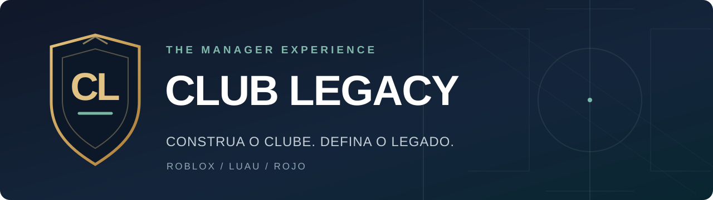

<div align="center">

# CL — Club Legacy

**Construa o clube. Defina o legado.**

Simulador de carreira de treinador para **Roblox**, desenvolvido em **Luau**, com compilação via **Rojo + GitHub Actions**.


</div>

> [!IMPORTANT]
> **Estado atual: código inicial do Claude integrado ao GitHub, ainda sem teste de compilação ou execução.**
> Os scripts de servidor, cliente e configuração recebidos do Claude foram integrados. **A compilação com Rojo passou; o funcionamento dentro do Roblox ainda não foi testado.** A publicação permanece desativada por padrão.

## O projeto

**CL - Club Legacy** será um jogo de gerenciamento de futebol, inspirado no gênero *Manager Career*, com identidade própria. O objetivo inicial é uma carreira de treinador **jogável pelo celular**, sem depender de partidas 3D.

| Foco da primeira versão | Planejamento |
| :--- | :--- |
| **Gestão de clube** | Criar/assumir um clube fictício |
| **Elenco e escalação** | Jogadores, posições, titulares e reservas |
| **Estratégia** | Formações e táticas que influenciam resultados |
| **Temporada** | Liga fictícia, calendário, simulação e classificação |
| **Mercado** | Compras, vendas e orçamento |
| **Carreira** | Evolução, salvamento e nova temporada |
| **Interface** | Menus adaptados a celulares Android |

Essas funcionalidades são **objetivos**, não recursos concluídos.

## Estado do desenvolvimento

| Área | Situação |
| :--- | :--- |
| Repositório e branch `main` | ✅ Criados |
| Estrutura Rojo e pastas Luau | ✅ Preparadas |
| GitHub Actions com instalação de Rojo 7.7.1 | ✅ Testado com sucesso em 02/11/2026 |
| IDs de destino da experiência Roblox | ✅ Definidos |
| Proteção contra publicação do código temporário | ✅ Ativa no workflow |
| Publicação do antigo Backrooms | ✅ Desativada no repositório antigo |
| Chave `ROBLOX_API_KEY` neste repositório | ⬜ Configuração manual pendente / não verificável |
| Código inicial do Claude (servidor, cliente e Config) | ✅ Integrado; testes pendentes |
| Compilação real do Club Legacy | ✅ Concluída: [primeira execução](https://github.com/blokadahub/club-legacy-roblox/actions/runs/41525520683) |
| Jogo funcional, DataStore e testes no Roblox | ⬜ Pendentes |
| Renomear a experiência no Creator Hub | ⬜ Pendente |

**[Acompanhe a checklist completa](CHECKLIST.md)** — separa infraestrutura, funcionalidades, testes e publicação.

## Estrutura do repositório

```text
club-legacy-roblox/
├── .github/
│   └── workflows/
│       └── publish.yml             # Compilar / publicar sob comando manual
├── assets/
│   └── club-legacy-banner.svg      # Identidade visual do README
├── src/
│   ├── server/
│   │   └── Main.server.luau        # Servidor integrado: aguardando testes
│   ├── client/
│   │   └── Main.client.luau        # Cliente integrado: aguardando testes
│   └── shared/
│       └── Config.luau             # Configuração pública compartilhada
├── default.project.json           # Mapeamento Rojo
├── INSTRUCOES-CLAUDE.md           # Contrato de entrega de arquivos
├── CHECKLIST.md                   # Estado técnico e próximas tarefas
└── README.md
```

O código definitivo poderá exigir outros módulos e atualizações em `default.project.json`. Nenhum segredo deve entrar na pasta `src/` nem no repositório.

## Experiência Roblox reutilizada

O projeto **Backrooms foi descontinuado**. Sua experiência Roblox existente será reaproveitada **exclusivamente para o CL - Club Legacy**:

| Identificador | Valor |
| :--- | :--- |
| **Universe ID** | `9749365367` |
| **Place ID** | `86256105108811` |
| **Experiência anterior** | `Local de bryanfranjudo` (teste Backrooms) |
| **Nome desejado** | `CL - Club Legacy` |

Os dois IDs públicos já estão definidos **diretamente no workflow do Club Legacy**, portanto **não é necessário cadastrar variáveis** `ROBLOX_UNIVERSE_ID` e `ROBLOX_PLACE_ID` neste repositório. A experiência ainda precisa ser renomeada manualmente no Roblox Creator Hub. **Alterar os arquivos do GitHub não muda o jogo publicado no Roblox.**

A publicação antiga foi desativada no repositório Backrooms, preservado apenas para consulta histórica.

## Configurar a chave Open Cloud

A chave **não pode ser recuperada ou copiada automaticamente** de outro repositório pelo GitHub conectado. Para permitir a publicação:

1. No Roblox Creator Hub, verifique que sua chave Open Cloud possui permissão de escrita de lugares (*universe-places: Write*) para o Universe ID acima. Reutilize uma chave válida que ainda possua ou crie outra.
2. Abra [Settings → Secrets and variables → Actions](https://github.com/blokadahub/club-legacy-roblox/settings/secrets/actions).
3. Cadastre **Repository secret** com o nome exato **`ROBLOX_API_KEY`**.
4. Cole a chave apenas no campo secreto do GitHub. **Nunca compartilhe o valor no chat, no README ou em arquivos de código.**

> [!WARNING]
> Ao executar a publicação do Club Legacy, o conteúdo publicado na experiência anterior será **substituído**. Faça isso somente após integrar e revisar o jogo. A operação não exclui o histórico do repositório Backrooms.

## Fluxo pelo celular

1. **Código integrado:** os três arquivos Lua enviados pelo Claude já estão neste repositório. Leia [INSTRUCOES-CLAUDE.md](INSTRUCOES-CLAUDE.md) caso sejam necessárias correções futuras.
2. **Verificar:** revise os scripts e confirme o mapeamento Rojo; não presuma que a compilação valida toda a jogabilidade.
3. **Compilar sem publicar:** abrir [Actions](https://github.com/blokadahub/club-legacy-roblox/actions), escolher **CL - Club Legacy | Construir e publicar** → **Run workflow**, deixando **`publicar` desmarcado**.
4. **Inspecionar resultado:** conferir a execução e baixar o artefato `club-legacy-rbxlx`. Uma compilação bem-sucedida **não significa** que as mecânicas estejam funcionando.
5. **Publicar quando estiver pronto:** após integrar o jogo, configurar o secret e aprovar a compilação, executar o mesmo workflow com **`publicar` marcado**.
6. **Testar no Roblox:** conferir entrada, interface, gestão, calendário, transferências, classificação, temporadas e salvamento. Se houver erros, corrigir no GitHub e publicar novamente.

## Regras técnicas

- O **servidor** deve controlar a carreira, o dinheiro, as transferências, os resultados e o salvamento.
- O **cliente** deve exibir as telas e solicitar ações; nunca decidir os resultados ou autorizar gastos por conta própria.
- `DataStoreService` deve ter tratamento de erros e não deve comunicar sucesso quando o salvamento falhar.
- Código gerado por IA requer revisão e teste dentro do Roblox.
- Nenhuma publicação acontece automaticamente a cada commit.

---

<div align="center">

**CL — Club Legacy** · Primeiro a carreira jogável. Depois, a expansão.

[Checklist](CHECKLIST.md) · [Orientações para o Claude](INSTRUCOES-CLAUDE.md) · [GitHub Actions](.github/workflows/publish.yml)

</div>
